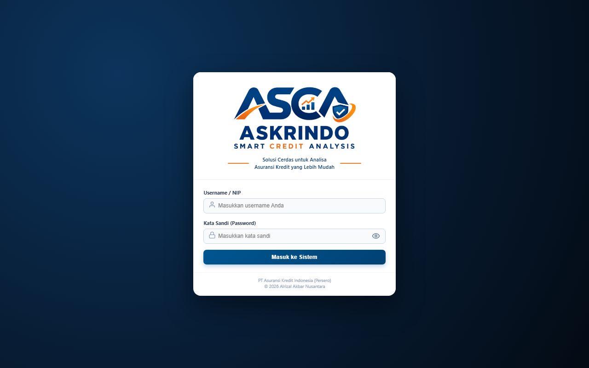
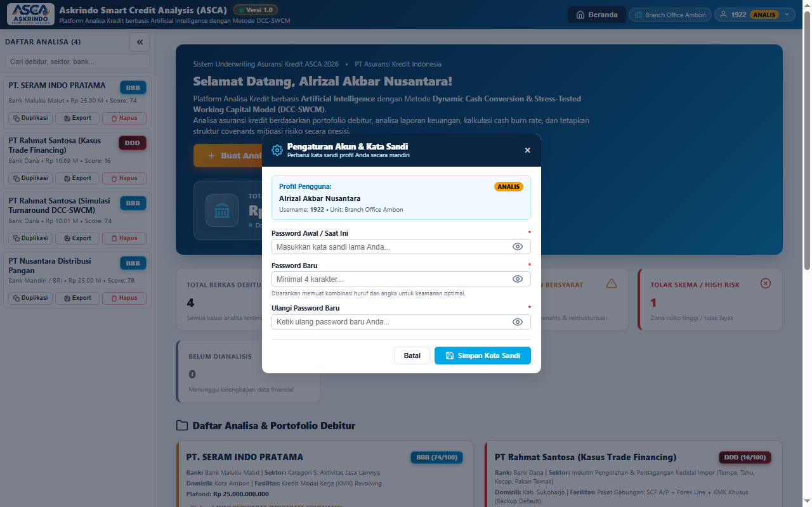
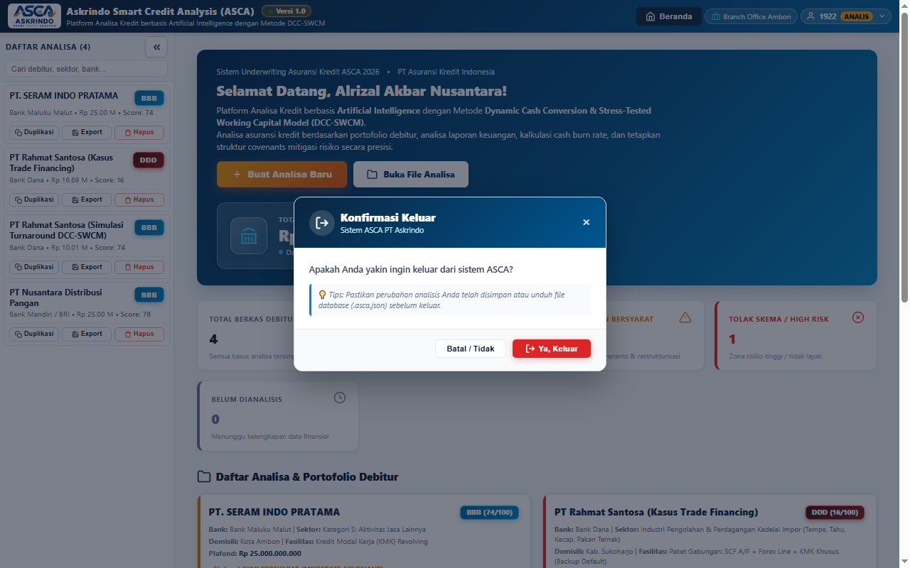
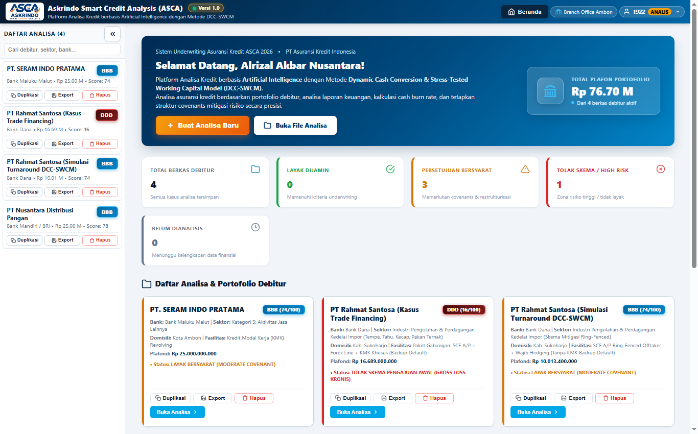
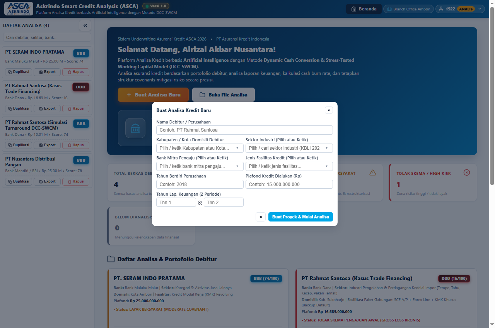
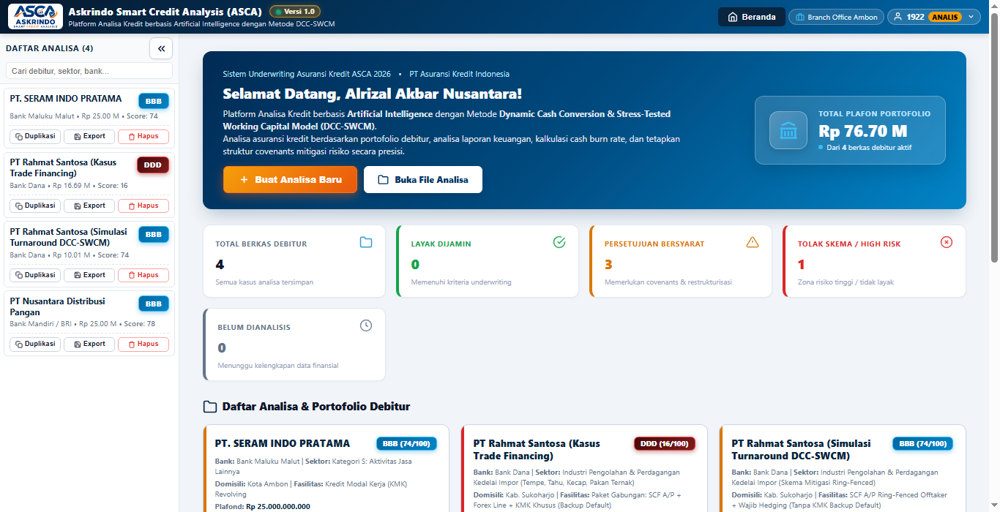
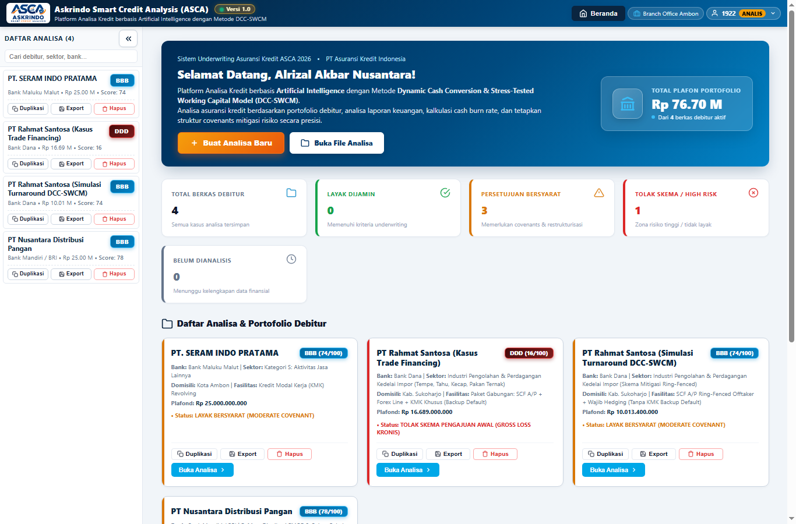
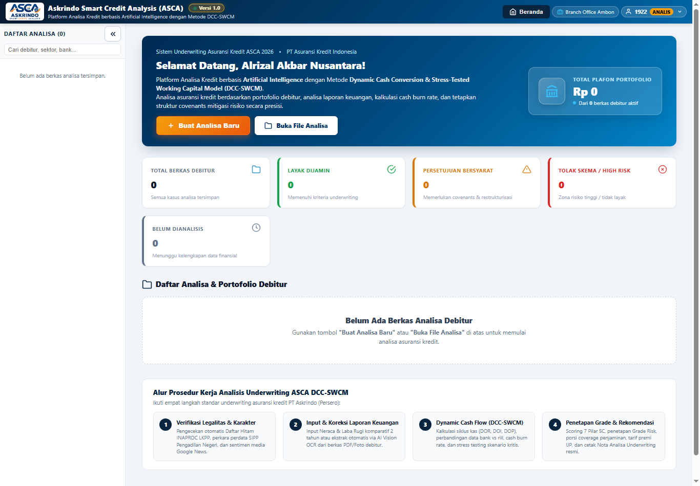
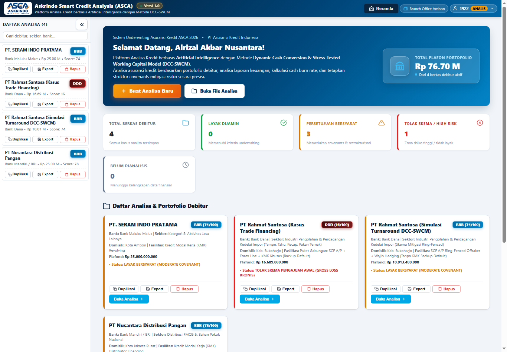
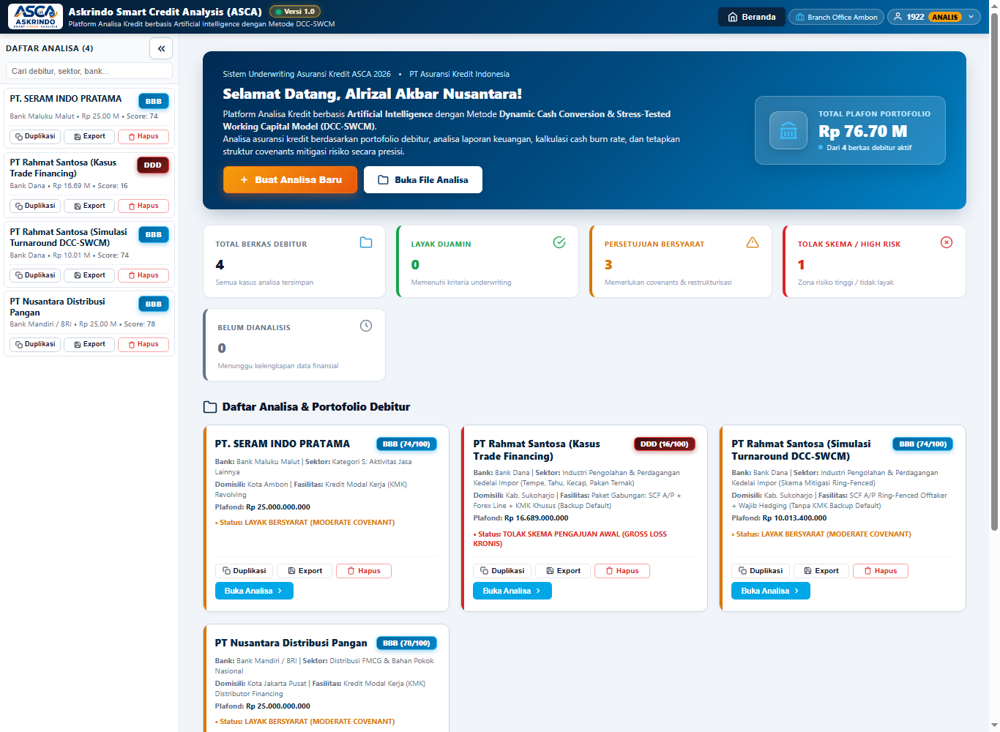

# USER MANUAL
# ASKRINDO SMART CREDIT ANALYSIS (ASCA)

| **PT ASURANSI KREDIT INDONESIA** | **USER MANUAL APLIKASI** | **No. Dok:** ASCA-UM-UW-2026-001 |
|:---:|:---:|:---|
|  | **PLATFORM ASCA (DCC-SWCM)** *Sistem Analisa Kredit & Akseptasi Penjaminan* | **Revisi:** 1.0 (Produksi) **Tanggal:** 3 November 2026 **Unit:** Divisi Underwriting Komersial |

---

## DAFTAR ISI

1. **PENDAHULUAN** ...................................................................................................................... 2
   - A. Tujuan Dokumen ................................................................................................................... 2
   - B. Riwayat Dokumen (*Document History*) ................................................................................. 2
   - C. Gambaran Umum Sistem ASCA ............................................................................................ 2
2. **BAB I: AUTENTIKASI & MANAJEMEN PENGGUNA** ................................................................... 3
   - 1.1 Akses & Login Sistem .......................................................................................................... 3
   - 1.2 Informasi Sesi & Profil Pengguna ........................................................................................... 4
   - 1.3 Pengaturan Akun & Ganti Kata Sandi ..................................................................................... 4
   - 1.4 Konfirmasi Keluar (*Safety Logout*) ....................................................................................... 5
3. **BAB II: BERANDA PORTAL & RINGKASAN PORTOFOLIO** .......................................................... 6
   - 2.1 Tampilan Beranda Portal (*Welcome Hub*) .............................................................................. 6
   - 2.2 Ringkasan Metrik Akseptasi & Portofolio ............................................................................... 7
   - 2.3 Tombol Aksi Cepat (*Quick Actions*) ...................................................................................... 8
4. **BAB III: MANAJEMEN BERKAS & SIDEBAR KASUS** ................................................................. 9
   - 3.1 Pencarian Debitur & Filter Cerdas ......................................................................................... 9
   - 3.2 Tampilan Sidebar (*Expand / Collapse*) ................................................................................ 10
   - 3.3 Aksi Duplikasi, Ekspor Kasus Tunggal, & Hapus .................................................................... 11
   - 3.4 Indikator Auto-Save Realtime ............................................................................................... 11
5. **BAB IV: PEMBUATAN PROYEK ANALISA BARU** ....................................................................... 12
   - 4.1 Form Modal Proyek Baru ..................................................................................................... 12
   - 4.2 Parameter Debitur, Plafond, & Tahun Buku ............................................................................ 13
   - 4.3 Ketentuan Inisialisasi Modul (*Empty-State Guard*) ............................................................... 14
6. **BAB V: HEADER ANALISA ADAPTIF 2-TIER** ............................................................................ 15
   - 5.1 Informasi Utama & Micro-Chips Metadata ............................................................................. 15
   - 5.2 Lingkaran Skor DCC-SWCM & Tautan Navigasi Cepat ............................................................. 16
   - 5.3 Keputusan Cepat & Rekomendasi Coverage ............................................................................ 17
   - 5.4 Tombol Simpan Global ke Cloud ........................................................................................... 17
7. **BAB VI: MODUL ANALISA INTI (10 TABS WORKSPACE)** ............................................................ 18
   - 6.1 Tab 1: Dashboard Debitur & Radar 5C ................................................................................. 18
   - 6.2 Tab 2: Input Parameter & Laporan Keuangan ........................................................................ 20
   - 6.3 Tab 3: Dynamic Cash Conversion (DCC) ............................................................................... 23
   - 6.4 Tab 4: Stress-Testing & Shock Sensitivitas ............................................................................ 25
   - 6.5 Tab 5: Net Working Capital (NWC) & CBRT ............................................................................ 27
   - 6.6 Tab 6: Proyeksi Cash Flow & Debt Service (DSCR) ................................................................. 29
   - 6.7 Tab 7: Grade Risk & Indikator Penyebab (10-Tier Rating) ....................................................... 31
   - 6.8 Tab 8: Rincian Perhitungan Skor DCC-SWCM ........................................................................ 33
   - 6.9 Tab 9: Rekomendasi Struktur Fasilitas & Mitigasi Risiko .......................................................... 35
   - 6.10 Tab 10: Review Analisa & Lembar Keputusan Underwriting .................................................... 37
8. **BAB VII: EKSPOR LAPORAN & PENCETAKAN RESMI** ................................................................. 40
   - 7.1 Ekspor Berkas JSON Portofolio ............................................................................................ 40
   - 7.2 Impor & Pemulihan Berkas Cadangan ................................................................................... 41
   - 7.3 Cetak Nota Review Analisa ke Format PDF ............................................................................ 41
9. **DAFTAR GAMBAR** ................................................................................................................. 42
10. **DAFTAR TABEL** ................................................................................................................... 43

---

## A. TUJUAN
User Manual ini disusun sebagai panduan operasional standar (*Standard Operating Procedure*) bagi pejabat dan staf penjaminan kredit PT Asuransi Kredit Indonesia (Persero) — meliputi **Analis Kredit (Underwriter)**, **Pemeriksa (Checker)**, dan **Pemutus / Pimpinan Cabang (Approver)** — dalam mengoperasikan sistem aplikasi **Askrindo Smart Credit Analysis (ASCA)**. Sistem ini memfasilitasi analisa kelayakan kredit, penilaian risiko multi-skenario, penentuan porsi penjaminan optimal, serta penyusunan nota review akseptasi berbasis kecerdasan komputasi (*AI-assisted*).

---

## B. DOCUMENT HISTORY

| Versi | Tanggal | Keterangan / Alasan Perubahan | Penyusun / Penanggung Jawab |
|:---:|:---:|:---|:---|
| **0.1** | 15 Okt 2026 | Perancangan arsitektur sistem analisa kredit DCC-SWCM dan struktur data awal. | Tim Pengembang ASCA |
| **0.5** | 25 Okt 2026 | Integrasi 10 Modul Analisa, simulasi stress-test makroekonomi, dan formula DSCR. | Underwriting AFCA |
| **0.9** | 30 Okt 2026 | Penerapan 10-tier Rating Akseptasi Askrindo (AAA s/d DDD) berbasis Juknis Surety Bond. | Tim Underwriting Komersial |
| **1.0** | 3 Nov 2026 | Rilis Produksi v1.0: Tata kelola sesi enterprise, header analisa adaptif full-width, portal beranda eksekutif, dan modul cetak nota review lengkap. | Alrizal Akbar Nusantara (Branch Office Ambon) |

---

## C. GAMBARAN UMUM SISTEM ASCA
Platform **ASCA** mengintegrasikan dua model evaluasi kredit modern:
1. **Dynamic Cash Conversion (DCC):** Mengukur kecepatan aktual siklus konversi piutang dan persediaan debitur menjadi kas riil setelah dikurangi tempo hutang usaha (*Trade Credit*).
2. **Stress-Tested Working Capital Model (SWCM):** Menguji ketahanan likuiditas modal kerja (*Net Working Capital*) dan waktu ketahanan kas (*Cash Burn Rate Time*) terhadap 4 variabel guncangan pasar (*shock*): penurunan omzet penjualan, lonjakan harga bahan baku (HPP), depresiasi kurs valuta asing (USD/IDR), dan kenaikan suku bunga pinjaman perbankan.

---

# BAB I: AUTENTIKASI & MANAJEMEN PENGGUNA

## 1.1 Akses & Login Sistem
Pengguna mengakses aplikasi ASCA melalui peramban web modern (*Google Chrome, Microsoft Edge, Mozilla Firefox*) melalui URL resmi: `https://askrindo.github.io/asca/`.

*Gambar 1. Halaman Login Sistem ASCA*

### Langkah-langkah Login:
1. Buka tautan sistem ASCA pada peramban.
2. Pada field **Username / NIP**, masukkan nomor identitas pegawai atau akun terdaftar (contoh: `1922` atau akun analis Anda).
3. Pada field **Kata Sandi (Password)**, ketikkan password akun Anda. Klik ikon mata untuk melihat karakter kata sandi jika diperlukan.
4. Klik tombol **Masuk ke Sistem**. Sistem akan memvalidasi kredensial dan mengarahkan pengguna ke **Beranda Portal Kasus**.

### Tabel 1. Elemen Field Halaman Login
| No | Field | Tipe | Sifat | Keterangan |
|:---:|:---|:---|:---|:---|
| 1 | Username / NIP | Alphanumeric | Wajib Diisi | Identitas unik pengguna atau Nomor Induk Pegawai (NIP). |
| 2 | Kata Sandi (Password) | Password | Wajib Diisi | Sandi pengaman akun. Dilengkapi enkripsi sesi lokal. |
| 3 | Tombol Show/Hide Password | Tombol Ikon | Opsional | Mengubah visibilitas teks kata sandi (sensor titik / teks polos). |
| 4 | Tombol Masuk ke Sistem | Tombol Submit | Wajib Diklik | Mengirimkan form dan menginisialisasi sesi kerja pengguna. |

---

## 1.2 Informasi Sesi & Profil Pengguna
Setelah berhasil masuk, bilah navigasi atas (*Top Navigation Bar*) akan menampilkan identitas dinamis pengguna yang aktif:
- **Unit Kerja / Divisi:** Menampilkan unit kerja pengguna (contoh: *Branch Office Ambon* atau *Divisi Underwriting Komersial*).
- **User Session Pill:** Menampilkan Nomor Pegawai/Username (`1922`), Role Pengguna (`Analis`), dan panah menu dropdown.

---

## 1.3 Pengaturan Akun & Ganti Kata Sandi
Pengguna dapat memperbarui kata sandi akun secara mandiri melalui menu profil.

*Gambar 16. Modal Pengaturan Akun & Ganti Password*

### Langkah-langkah Mengganti Kata Sandi:
1. Klik pada **User Session Pill** di pojok kanan atas bilah navigasi.
2. Pilih submenu **Pengaturan & Ganti Password**. Jendela modal dialog akan muncul di tengah layar.
3. Masukkan kata sandi saat ini pada field **Password Lama**.
4. Masukkan sandi baru pada field **Password Baru** (minimal 6 karakter).
5. Masukkan ulang sandi baru pada field **Konfirmasi Password Baru**.
6. Klik tombol **Simpan Password Baru**. Sistem akan memverifikasi kecocokan dan menampilkan notifikasi sukses.

### Tabel 2. Field Modal Pengaturan Akun
| No | Field | Tipe | Keterangan |
|:---:|:---|:---|:---|
| 1 | User ID | Read-only | Username / NIP pengguna yang sedang login. |
| 2 | Nama Lengkap | Read-only | Nama resmi pemegang akun. |
| 3 | Role / Hak Akses | Read-only | Peran otorisasi (*Analyst*, *Approver*, atau *Admin*). |
| 4 | Password Lama | Input Password | Kata sandi aktif saat ini untuk validasi keamanan. |
| 5 | Password Baru | Input Password | Kata sandi pengganti yang diinginkan. |
| 6 | Konfirmasi Password Baru | Input Password | Harus identik dengan field Password Baru. |

---

## 1.4 Konfirmasi Keluar (*Safety Logout*)
Untuk mencegah penutupan sesi yang tidak disengaja saat proses analisa berlangsung, ASCA dilengkapi dialog konfirmasi dua langkah.

*Gambar 17. Dialog Konfirmasi Keluar dari Sistem*

### Langkah-langkah Keluar:
1. Klik tombol **User Session Pill** di pojok kanan atas, lalu klik **Keluar dari Akun**.
2. Kotak dialog peringatan akan muncul: *"Apakah Anda yakin ingin keluar dari sistem ASCA?"*.
3. Klik tombol merah **Ya, Keluar** untuk mengakhiri sesi, atau klik **Batal** untuk melanjutkan pekerjaan.

---

# BAB II: BERANDA PORTAL & RINGKASAN PORTOFOLIO

## 2.1 Tampilan Beranda Portal (*Welcome Hub*)
Beranda Portal merupakan pusat kendali eksekutif yang menyajikan ikhtisar seluruh berkas analisa debitur, statistik kelayakan kredit, serta jalan pintas pembuatan kasus baru.

*Gambar 2. Beranda Portal & Ringkasan Portofolio Kasus*

---

## 2.2 Ringkasan Metrik Akseptasi & Portofolio
Pada bagian tengah portal terdapat kartu metrik portofolio yang dikalkulasi secara realtime:

### Tabel 3. Kartu Metrik Portofolio Beranda
| No | Kartu Indikator | Warna Aksen | Keterangan & Definisi |
|:---:|:---|:---|:---|
| 1 | **Total Plafon Portofolio** | Biru Gradasi | Akumulasi total nilai permohonan plafond penjaminan kredit dari seluruh berkas debitur aktif. |
| 2 | **Total Berkas Debitur** | Biru Muda | Jumlah total berkas analisa kredit yang tersimpan di dalam memori sistem. |
| 3 | **Layak Dijamin** | Hijau (*Emerald*) | Jumlah kasus dengan hasil evaluasi *Layak Penuh* (Rekomendasi penjaminan standar s/d 80%-90%). |
| 4 | **Persetujuan Bersyarat** | Oranye (*Amber*) | Jumlah kasus dengan status *Conditional Approval* (memerlukan *Cash Collateral*, restrukturisasi skema, atau porsi penjaminan maksimum 55%-70%). |
| 5 | **Tolak Skema / High Risk** | Merah (*Crimson*) | Jumlah kasus yang tidak layak dijamin (*Uninsurable / Reject*) akibat masalah likuiditas parah, gross loss, atau rasio DSCR kritis. |
| 6 | **Belum Dianalisis** | Abu-abu | Kasus baru yang belum diinput data laporan keuangannya (*Zero Financials*). |

---

## 2.3 Tombol Aksi Cepat (*Quick Actions*)
- **Tombol `+ Buat Analisa Baru` (Warna Oranye Kontras Tinggi):** Membuka modal pendaftaran proyek debitur baru.
- **Tombol `Buka File Analisa` (Putih Bersih):** Membuka file explorer lokal komputer untuk mengimpor file cadangan database (`.asca.json`).
- **Tombol Navigasi `Beranda` pada Header:** Mengembalikan tampilan layar ke portal ini kapan saja saat berada di dalam lembar kerja analisa kasus.

---

# BAB III: MANAJEMEN BERKAS & SIDEBAR KASUS

## 3.1 Pencarian Debitur & Filter Cerdas
Sidebar sebelah kiri memuat seluruh arsip debitur yang tersimpan. Pengguna dapat mencari berkas secara instan menggunakan kolom pencarian di bagian atas sidebar.

*Gambar 4. Sidebar Kasus & Tata Letak Ruang Kerja*

### Fitur Kolom Pencarian:
- **Pencarian Multi-Atribut:** Pengguna dapat mengetikkan nama perusahaan debitur, nama bank penyalur kredit, maupun nama sektor usaha.
- **Tombol Clear Search (`×`):** Menghapus kata kunci pencarian seketika untuk menampilkan kembali seluruh daftar debitur.
- **Proteksi Anti-Autofill:** Field dilengkapi atribut proteksi khusus sehingga kredensial akun peramban tidak akan pernah bocor tertempel ke kolom pencarian kasus.

---

## 3.2 Tampilan Sidebar (*Expand / Collapse*)
- Untuk memperluas area pandang tabel keuangan pada layar laptop atau monitor berukuran kecil, klik tombol panah lipat (`«`) di sudut kanan atas header sidebar.
- Sidebar akan menciut (*collapse*) menjadi bilah ramping dengan indikator jumlah kasus.
- Klik ikon panah buka (`»`) pada bilah ramping tersebut untuk membuka kembali daftar lengkap analisa debitur.

---

## 3.3 Aksi Duplikasi, Ekspor Kasus Tunggal, & Hapus
Setiap kartu debitur pada sidebar dilengkapi 3 tombol aksi mikro:
1. **Tombol Duplikasi:** Menyalin seluruh data debitur, neraca, laba rugi, dan parameter kredit ke dalam berkas kasus baru dengan imbuhan nama `(Salinan)`. Fitur ini sangat berguna untuk melakukan simulasi skenario alternatif tanpa mengubah berkas asli.
2. **Tombol Export:** Mengunduh berkas analisa debitur tersebut ke dalam format JSON tunggal (`[Nama_Debitur].json`).
3. **Tombol Hapus:** Menghapus berkas analisa debitur secara permanen setelah mendapatkan konfirmasi persetujuan dari pengguna.

---

## 3.4 Indikator Auto-Save Realtime
Pada bagian footer sidebar terdapat indikator status penyimpanan otomatis:
`✓ Tersimpan otomatis (Database Cloud Aktif)`
Setiap kali pengguna melakukan perubahan angka atau teks pada form, ASCA secara otomatis menyimpan perubahan ke *Local Storage* dan mengunggahnya ke repositori *Cloud Storage* tanpa perlu menekan tombol simpan berulang-ulang.

---

# BAB IV: PEMBUATAN PROYEK ANALISA BARU

## 4.1 Form Modal Proyek Baru
Untuk menganalisa debitur yang baru mengajukan permohonan penjaminan kredit, pengguna membuka form pembuatan proyek baru.

*Gambar 3. Modal Pembuatan Proyek Analisa Baru*

### Langkah-langkah Pembuatan Proyek Baru:
1. Klik tombol **`+ Buat Analisa Baru`** pada Beranda Portal atau ikon tambah pada sidebar.
2. Jendela modal dialog *Buat Analisa Kredit Baru* akan terbuka.
3. Lengkapi seluruh isian parameter sesuai dokumen permohonan kredit yang diterima dari bank mitra.
4. Klik tombol **Buat Proyek & Mulai Analisa**.

---

### Tabel 4. Field Modal Analisa Baru
| No | Field | Tipe Kontrol | Keterangan / Pilihan |
|:---:|:---|:---|:---|
| 1 | **Nama Perusahaan / Debitur** | Text Input | Nama resmi badan usaha calon terjamin (PT / CV / Koperasi). |
| 2 | **Nama Bank Penyalur Kredit** | Combobox / Text | Bank mitra penyalur kredit (contoh: Bank Mandiri, BRI, BNI, Bank Dana, Bank Maluku Malut). |
| 3 | **Jenis Fasilitas Kredit** | Dropdown Menu | Pilihan fasilitas: *KMK Revolving, KMK Transaksional, SCF AP, Forex Line, atau Paket Gabungan*. |
| 4 | **Sektor Usaha / Industri** | Dropdown Menu | Klasifikasi lapangan usaha sesuai KBLI / Sektor Askrindo (Perdagangan, Manufaktur, Konstruksi, Jasa, dll.). |
| 5 | **Kota / Domisili Usaha** | Text Input | Kota atau Kabupaten lokasi kantor pusat / operasional debitur. |
| 6 | **Plafond Kredit yang Dimohonkan** | Numeric (Rupiah) | Nilai nominal permohonan kredit dalam satuan Rupiah (contoh: Rp 16.689.000.000). |
| 7 | **Tahun Laporan Keuangan 1 (Historis)** | Numeric (Tahun) | Tahun buku keuangan awal yang akan diinput (contoh: 2022). |
| 8 | **Tahun Laporan Keuangan 2 (Terbaru)** | Numeric (Tahun) | Tahun buku keuangan pembanding/terbaru (contoh: 2023). |

---

## 4.3 Ketentuan Inisialisasi Modul (*Empty-State Guard*)
> [!IMPORTANT]
> **Prinsip Integritas Analisa Keuangan:**  
> Saat proyek baru pertama kali dibuat, sistem ASCA **TIDAK AKAN** menampilkan estimasi skor palsu, angka rekomendasi tiruan, ataupun hasil stress-test sebelum Analis menginputkan data Laporan Keuangan (Neraca & Laba Rugi). Seluruh modul kalkulasi (DCC, Stress-Test, NWC, Cash Flow, Grade Risk, Rincian Skor, dan Review Analisa) akan menampilkan kartu panduan *Empty-State* yang mengarahkan Analis untuk menginput data keuangan pada **Tab 2** terlebih dahulu.

---

# BAB V: HEADER ANALISA ADAPTIF 2-TIER

## 5.1 Informasi Utama & Micro-Chips Metadata
Header Analisa (`.case-banner`) dirancang dengan struktur 2-Tier adaptif yang responsif pada semua ukuran resolusi layar:

*Gambar 5. Header Analisa Adaptif 2-Tier*

- **Tier 1 (Informasi Debitur & Micro-Chips):**
  - **Nama Perusahaan:** Ditampilkan dengan tipografi tegas (*Navy Blue Bold*).
  - **Badges Utama:** Badge Rating Risiko (*contoh: DDD (16/100)*), Status Kelayakan Penjaminan (*contoh: Tidak Layak / Layak Bersyarat*), dan Jenis Fasilitas Pembiayaan.
  - **Structured Micro-Chips:** Wadah ringkas berlatar `#f8fafc` dengan garis halus `#e2e8f0` yang memuat metadata penting:
    - `BANK`: Nama bank kreditor.
    - `SEKTOR`: Bidang usaha (teks panjang dilengkapi pemotongan *ellipsis* dan tooltip *title* saat disentuh kursor).
    - `DOMISILI`: Kota kedudukan debitur.
    - `PLAFOND`: Plafon pengajuan kredit terformat Rupiah.
    - `LAP. KEU`: Dua tahun buku keuangan yang dievaluasi.
    - `UNDERWRITER`: Nama analis pembuat berkas.
    - `UNIT / DIVISI`: Cabang penjaminan Askrindo terkait.

---

## 5.2 Lingkaran Skor DCC-SWCM & Tautan Navigasi Cepat
- **Lingkaran Skor Interaktif (`score-circle`):** Menampilkan skor komposit skala 0 s/d 100 dengan warna yang berubah otomatis sesuai grade risiko (Merah: High Risk/DDD, Oranye: Moderate/BB, Hijau: Prime/AAA). Klik lingkaran ini untuk langsung melompat ke lembar Rincian Skor.
- **Tautan Navigasi Cepat (Pill Badges):**
  - `Analisa 5C`: Melompat ke grafik radar evaluasi 5C.
  - `Rincian Skor`: Melompat ke tabel perhitungan bobot penilaian.
  - `Indikator Grade`: Melompat ke matriks grade rating akseptasi.

---

## 5.3 Keputusan Cepat & Rekomendasi Coverage
- **Pill Keputusan Akseptasi:** Menampilkan kesimpulan tegas (misal: `TOLAK SKEMA PENGAJUAN AWAL (GROSS LOSS KRONIS)` atau `PERSETUJUAN BERSYARAT DENGAN RESTRUKTURISASI`).
- **Baris Rekomendasi Coverage:** Menampilkan porsi penjaminan maksimum yang disarankan dan estimasi IJP (*Imbal Jasa Penjaminan*).

---

## 5.4 Tombol Simpan Global ke Cloud
Tombol **`[ 💾 Simpan ]`** terletak kokoh di ujung kanan Tier 2 (`align-self: stretch`). Menekan tombol ini akan mengompilasi seluruh tab dan menyimpannya secara permanen ke pangkalan data cloud.

---

# BAB VI: MODUL ANALISA INTI (10 TABS WORKSPACE)

Workspace ASCA terbagi ke dalam 10 Tab Analisa komprehensif yang saling terhubung secara terpadu.

---

## 6.1 Tab 1: Dashboard Debitur & Radar 5C
Menyajikan rangkuman eksekutif visual yang ideal untuk presentasi komite kredit dan review manajemen.

*Gambar 6. Tab 1 - Dashboard Debitur & Radar 5C*

### Fitur Utama Tab Dashboard:
1. **Grafik Radar 5C:** Visualisasi polygon 5 dimensi kredit (*Character, Capacity, Capital, Collateral, Condition*) membandingkan profil debitur terhadap standar minimum akseptasi Askrindo.
2. **Kartu Skor Kuantitatif & Kualitatif:** Pemisahan skor aspek rasio keuangan dan aspek kelayakan kualitatif operasional.
3. **Ringkasan Indikator Keuangan Kunci:** Menampilkan metrik DCC (hari), NWC (Rp), DSCR (kali), dan Debt-to-Equity Ratio (DER).

---

## 6.2 Tab 2: Input Parameter & Laporan Keuangan
Merupakan fondasi utama kalkulasi sistem. Analis menginputkan data finansial debitur selama dua periode tahun buku terakhir.

*Gambar 7. Tab 2 - Parameter Debitur & Laporan Keuangan*

### Tabel 5. Komponen Input Laporan Keuangan Tab 2
| No | Bagian Laporan | Field / Akun Finansial | Fungsi dalam Perhitungan DCC-SWCM |
|:---:|:---|:---|:---|
| 1 | **Profil & Fasilitas** | Limit SCF, Limit Forex, Suku Bunga (%) | Menghitung beban bunga tahunan dan batas likuiditas penjaminan. |
| 2 | **Neraca - Aset Lancar** | Kas & Setara Kas | Komponen utama likuiditas primer dan ketahanan *Cash Burn Rate*. |
| 3 | | Piutang Usaha | Menghitung *Days Sales Outstanding* (DSO) dan perputaran piutang. |
| 4 | | Persediaan Barang (*Inventory*) | Menghitung *Days Inventory Outstanding* (DIO) dan kebutuhan modal kerja. |
| 5 | | Aset Lancar Lainnya | Menghitung total aktiva lancar dan rasio *Current Ratio*. |
| 6 | **Neraca - Kewajiban Lancar**| Hutang Usaha (*Trade Payables*) | Menghitung *Days Payable Outstanding* (DPO) dan siklus pembiayaan supplier. |
| 7 | | Hutang Bank Jangka Pendek | Komponen kewajiban lancar yang jatuh tempo dalam 12 bulan. |
| 8 | | Kewajiban Lancar Lainnya | Menghitung total *Current Liabilities* untuk penentuan NWC. |
| 9 | **Neraca - Solvabilitas** | Total Hutang & Total Ekuitas | Menghitung rasio solvabilitas *Debt to Equity Ratio* (DER) dan *Debt to Asset*. |
| 10 | **Laba Rugi** | Penjualan / Pendapatan Usaha | Menghitung pertumbuhan omzet (*Sales Growth*) dan basis rasio efisiensi. |
| 11 | | Harga Pokok Penjualan (HPP) | Menghitung *Gross Profit Margin* (GPM) dan rasio perputaran persediaan. |
| 12 | | Beban Operasional / Umum | Menghitung *Cash Burn Rate* bulanan dan laba operasional (EBITDA). |
| 13 | | Laba Bersih (*Net Profit*) | Menghitung *Net Profit Margin* (NPM), ROA, dan ROE. |

---

## 6.3 Tab 3: Dynamic Cash Conversion (DCC)
Modul ini mengkalkulasi efisiensi arus siklus kas operasional debitur dari saat pembelian bahan baku hingga penerimaan pelunasan tagihan.

*Gambar 8. Tab 3 - Dynamic Cash Conversion Cycle*

### Tabel 6. Rumus & Parameter DCC
| Parameter | Formula Komputasi | Interpretasi Underwriting |
|:---|:---|:---|
| **Days Sales Outstanding (DSO)** | $\text{DSO} = \frac{\text{Piutang Usaha}}{\text{Penjualan Tahunan}} \times 365$ | Rata-rata hari yang dibutuhkan debitur untuk menagih piutang dari pembeli. |
| **Days Inventory Outstanding (DIO)** | $\text{DIO} = \frac{\text{Persediaan}}{\text{HPP Tahunan}} \times 365$ | Rata-rata hari lamanya barang mengendap di gudang sebelum berhasil terjual. |
| **Days Payable Outstanding (DPO)** | $\text{DPO} = \frac{\text{Hutang Usaha}}{\text{HPP Tahunan}} \times 365$ | Rata-rata tempo pembayaran yang diperoleh debitur dari pemasok/supplier. |
| **DCC Net Cycle (Hari)** | $\text{DCC} = \text{DSO} + \text{DIO} - \text{DPO}$ | Kesenjangan waktu (*cash gap*) di mana debitur membutuhkan talangan modal kerja. Siklus yang memanjang mengindikasikan risiko likuiditas tinggi. |

---

## 6.4 Tab 4: Stress-Testing & Shock Sensitivitas
Menguji ketahanan kinerja debitur apabila terjadi kondisi makroekonomi dan operasional yang memburuk secara drastis.

*Gambar 9. Tab 4 - Simulasi Stress-Testing & Shock Sensitivitas*

### 4 Variabel Shock Skenario:
1. **Shock Penurunan Omzet (Sales Shock):** Menyimulasikan penurunan omzet 10% s/d 30% akibat kontraksi pasar.
2. **Shock Kenaikan HPP (COGS Shock):** Menyimulasikan kenaikan harga bahan baku impor sebesar 10% s/d 25%.
3. **Shock Fluktuasi Kurs (FX USD/IDR Shock):** Menyimulasikan depresiasi Rupiah (misal Rp 15.500 $\rightarrow$ Rp 17.500 per USD).
4. **Shock Suku Bunga (Interest Rate Shock):** Menyimulasikan kenaikan suku bunga kredit bank 200 s/d 500 bps.

---

## 6.5 Tab 5: Net Working Capital (NWC) & CBRT
Menghitung ketersediaan modal kerja riil dan berapa lama kas debitur mampu bertahan hidup (*survival runway*).

*Gambar 10. Tab 5 - NWC & Cash Burn Rate Time*

### Tabel 7. Indikator NWC & CBRT
| Metrik | Formula | Standar Ambang Batas |
|:---|:---|:---|
| **Net Working Capital (NWC)** | $\text{NWC} = \text{Aset Lancar} - \text{Kewajiban Lancar}$ | Harus bernilai positif ($> 0$). Jika negatif, debitur berisiko gagal bayar jangka pendek. |
| **Monthly Cash Burn Rate (CBR)** | $\text{CBR} = \frac{\text{Beban Operasional Tahunan} + \text{Beban Bunga}}{12}$ | Kebutuhan kas bulanan untuk membiayai operasional tetap debitur. |
| **Cash Burn Rate Time (CBRT)** | $\text{CBRT} = \frac{\text{Kas \& Setara Kas}}{\text{Monthly CBR}}$ | Waktu bertahan kas (dalam bulan). Minimum sehat adalah $\ge 3$ bulan. |

---

## 6.6 Tab 6: Proyeksi Cash Flow & Debt Service (DSCR)
Memproyeksikan arus kas bulanan selama 12 bulan ke depan untuk menguji kemampuan membayar angsuran pokok dan bunga bank (*Debt Service*).

*Gambar 11. Tab 6 - Proyeksi Cash Flow & DSCR*

### Rumus Debt Service Coverage Ratio (DSCR):
$$\text{DSCR} = \frac{\text{Cash Flow Available for Debt Service (CFADS)}}{\text{Angsuran Pokok Pinjaman} + \text{Beban Bunga Pinjaman}}$$
- **DSCR $\ge 1.30\times$:** Sangat Layak (*Prime/Superior*).
- **$1.00\times \le \text{DSCR} < 1.30\times$:** Layak Bersyarat (*Moderate*).
- **DSCR $< 1.00\times$:** Defisit Arus Kas (*Inadequate / High Risk*).

---

## 6.7 Tab 7: Grade Risk & Indikator Penyebab (10-Tier Rating)
Menetapkan peringkat rating akseptasi resmi Askrindo berdasarkan tabel standardisasi industri penjaminan kredit.

*Gambar 12. Tab 7 - Penentuan Grade Risk 10-Tier*

### Tabel 8. Matriks 10-Tier Rating Akseptasi Askrindo
*(Mengacu pada Tabel VI.1 Petunjuk Teknis Suretyship Askrindo / Standar PT IDX Consulting)*
| Rating Grade | Rentang Skor | Kategori Risiko | Rekomendasi Akseptasi Askrindo | Porsi Coverage Maks. |
|:---:|:---:|:---|:---|:---:|
| **AAA** | $91 - 100$ | Risiko Sangat Rendah | Disetujui Penuh (Tanpa Syarat Khusus) | $90\%$ |
| **AA** | $81 - 90$ | Risiko Rendah | Disetujui Penuh (Fasilitas Standar) | $85\%$ |
| **A** | $71 - 80$ | Risiko Terkendali Baik | Disetujui Penuh | $80\%$ |
| **BBB** | $61 - 70$ | Risiko Sedang (*Investment Grade*) | Disetujui dengan Pemantauan Berkala | $75\%$ |
| **BB** | $51 - 60$ | Risiko Cukup Tinggi | Persetujuan Bersyarat (*Covenants Ketat*) | $70\%$ |
| **B** | $41 - 50$ | Risiko Tinggi | Persetujuan Bersyarat (*Cash Collateral*) | $60\%$ |
| **CCC** | $31 - 40$ | Risiko Sangat Rentan | Pembatasan Ketat (*Escrow Account*) | $55\%$ |
| **CC** | $21 - 30$ | Risiko Sangat Tinggi / Defisit | Tolak Skema Awal (Restrukturisasi Wajib) | $50\%$ |
| **C** | $11 - 20$ | Kerugian Kronis / Insolvensi | **Tolak Akseptasi Penjaminan** | Opsi Maks $55\%$ |
| **DDD** | $0 - 10$ | Default / Uninsurable | **Tolak Mutlak (*Uninsurable*)** | $0\%$ |

---

## 6.8 Tab 8: Rincian Perhitungan Skor DCC-SWCM
Menyajikan pembobotan matematis transparan dari prinsip analisa kredit 5C Askrindo.

*Gambar 13. Tab 8 - Rincian Perhitungan Skor DCC-SWCM*

### Tabel 9. Pembobotan Aspek 5C DCC-SWCM
| Pilar 5C | Bobot | Parameter Evaluasi Utama |
|:---|:---:|:---|
| **Character (Watak)** | $15\%$ | Riwayat kolektibilitas BI Checking / SLIK OJK, integritas manajemen, blacklist INAPROC. |
| **Capacity (Kapasitas)** | $30\%$ | Siklus DCC, rasio DSCR, pertumbuhan omzet, perputaran piutang & persediaan. |
| **Capital (Permodalan)** | $25\%$ | Modal Kerja Bersih (NWC), Debt-to-Equity Ratio (DER), profitabilitas (GPM & NPM). |
| **Collateral (Agunan)** | $15\%$ | Nilai taksasi agunan *fixed assets*, pengikatan hak tanggungan, agunan likuid (*Cash/Deposito*). |
| **Condition (Kondisi Makro)**| $15\%$ | Ketahanan terhadap shock valas, ketergantungan impor, prospek industri debitur. |

---

## 6.9 Tab 9: Rekomendasi Struktur Fasilitas & Mitigasi Risiko
Memberikan panduan klausul syarat persetujuan (*covenants*) dan restrukturisasi fasilitas kredit bagi bank mitra penjaminan.

*Gambar 14. Tab 9 - Rekomendasi Fasilitas & Mitigasi Risiko*

### Klausul Mitigasi Risiko Khusus Askrindo:
1. **Penyaluran Bertahap (*Tranche Disbursement*):** Penarikan kredit tidak diberikan sekaligus melainkan berbasis dokumen progres transaksi (*Invoice Verified*).
2. **Penyediaan Escrow Account:** Seluruh penerimaan pembayaran dari debitur wajib dialirkan melalui rekening penampungan di bank penyalur kredit.
3. **Penyertaan Cash Collateral Tambahan:** Mewajibkan agunan tunai atau sertifikat deposito minimal 10%-20% dari total plafond.

---

## 6.10 Tab 10: Review Analisa & Lembar Keputusan Underwriting
Dokumen resmi akhir yang merangkum keseluruhan analisa kredit, pertimbangan underwriter, dan jalur tanda tangan berjenjang (*Maker - Checker - Approver*).

*Gambar 15. Tab 10 - Review Analisa & Lembar Keputusan*

### Tabel 10. Elemen Lembar Keputusan Review Analisa
| No | Bagian Form | Isian Data | Pejabat Penanggung Jawab |
|:---:|:---|:---|:---|
| 1 | **Opini Analis Kredit** | Catatan evaluasi, pertimbangan risiko utama, dan rekomendasi struktural. | Analis Kredit / Underwriter |
| 2 | **Tanda Tangan Maker** | Nama Analis, NIP, Jabatan (*Underwriter Ahli Pertama*), Tanggal. | Pembuat Berkas (*Maker*) |
| 3 | **Tanda Tangan Checker** | Nama Pemeriksa, NIP, Jabatan (*Kasi Underwriting Komersial*), Tanggal. | Pemeriksa Berkas (*Checker*) |
| 4 | **Tanda Tangan Approver**| Nama Pejabat Pemutus, NIP, Jabatan (*Pemimpin Cabang / Kadiv*), Tanggal. | Pejabat Pemutus (*Approver*) |
| 5 | **Tombol Cetak PDF** | Mencetak nota review ke format dokumen resmi PDF siap bubuh tanda tangan basah / digital. | Seluruh Pejabat Berwenang |

---

# BAB VII: EKSPOR LAPORAN & PENCETAKAN RESMI

## 7.1 Ekspor Berkas JSON Portofolio
- Untuk mencadangkan seluruh data analisa kasus dari akun pengguna, klik tombol **User Menu** $\rightarrow$ pilih **Export Seluruh Database (.json)**.
- Sistem akan mengunduh berkas dengan format:  
  `ASCA_Workspace_Backup_[Tanggal].json`

## 7.2 Impor & Pemulihan Berkas Cadangan
- Pada Beranda Portal, klik tombol **Buka File Analisa** atau tombol **Impor Database** di bilah atas.
- Pilih berkas cadangan `.json`. Sistem ASCA akan secara otomatis memulihkan seluruh arsip debitur, neraca, dan hasil kalkulasi tanpa ada data yang hilang.

## 7.3 Cetak Nota Review Analisa ke Format PDF
1. Buka Tab 10 (**Review Analisa**).
2. Periksa kembali kelengkapan catatan opini analis dan pejabat penandatangan.
3. Klik tombol biru **`[ 🖨️ Cetak / Ekspor PDF ]`** di bagian atas lembar nota review.
4. Jendela dialog cetak peramban akan terbuka:
   - Pilih Printer: **Save as PDF** / **Simpan sebagai PDF**.
   - Ukuran Kertas: **A4**.
   - Margin: **Default / Minimum**.
   - Opsi: Centang opsi **Background graphics / Gambar latar belakang**.
5. Klik **Save** untuk menyimpan dokumen resmi akseptasi penjaminan.

---

## DAFTAR GAMBAR

- **Gambar 1.** Halaman Login Sistem ASCA ....................................................................................... 3
- **Gambar 2.** Beranda Portal & Ringkasan Portofolio Kasus (*Welcome Hub*) ........................................ 6
- **Gambar 3.** Modal Pembuatan Proyek Analisa Baru ....................................................................... 12
- **Gambar 4.** Sidebar Kasus & Tata Letak Ruang Kerja ...................................................................... 9
- **Gambar 5.** Header Analisa Adaptif 2-Tier (`.case-banner`) ............................................................. 15
- **Gambar 6.** Tab 1 - Dashboard Debitur & Radar 5C ......................................................................... 18
- **Gambar 7.** Tab 2 - Parameter Debitur & Laporan Keuangan ........................................................... 20
- **Gambar 8.** Tab 3 - Dynamic Cash Conversion Cycle (DCC) ........................................................... 23
- **Gambar 9.** Tab 4 - Simulasi Stress-Testing & Shock Sensitivitas ..................................................... 25
- **Gambar 10.** Tab 5 - Net Working Capital (NWC) & Cash Burn Rate Time (CBRT) .............................. 27
- **Gambar 11.** Tab 6 - Proyeksi Cash Flow & Debt Service (DSCR) ..................................................... 29
- **Gambar 12.** Tab 7 - Penentuan Grade Risk 10-Tier Askrindo (AAA s/d DDD) ..................................... 31
- **Gambar 13.** Tab 8 - Rincian Perhitungan Skor DCC-SWCM (Bobot 5C) ........................................... 33
- **Gambar 14.** Tab 9 - Rekomendasi Struktur Fasilitas & Mitigasi Risiko ............................................. 35
- **Gambar 15.** Tab 10 - Review Analisa & Lembar Keputusan Underwriting ........................................ 37
- **Gambar 16.** Modal Pengaturan Akun & Ganti Password .................................................................. 4
- **Gambar 17.** Dialog Konfirmasi Keluar dari Sistem (*Safety Logout*) ................................................ 5

---

## DAFTAR TABEL

- **Tabel 1.** Elemen Field Halaman Login ........................................................................................... 3
- **Tabel 2.** Field Modal Pengaturan Akun ............................................................................................ 4
- **Tabel 3.** Kartu Metrik Portofolio Beranda ....................................................................................... 7
- **Tabel 4.** Field Modal Analisa Baru ................................................................................................. 13
- **Tabel 5.** Komponen Input Laporan Keuangan Tab 2 ....................................................................... 21
- **Tabel 6.** Rumus & Parameter Dynamic Cash Conversion (DCC) ...................................................... 24
- **Tabel 7.** Indikator Net Working Capital (NWC) & CBRT ................................................................... 28
- **Tabel 8.** Matriks 10-Tier Rating Akseptasi Askrindo (Tabel VI.1 Juknis) ............................................ 32
- **Tabel 9.** Pembobotan Aspek 5C DCC-SWCM ................................................................................. 34
- **Tabel 10.** Elemen Lembar Keputusan Review Analisa Tab 10 ........................................................... 38
